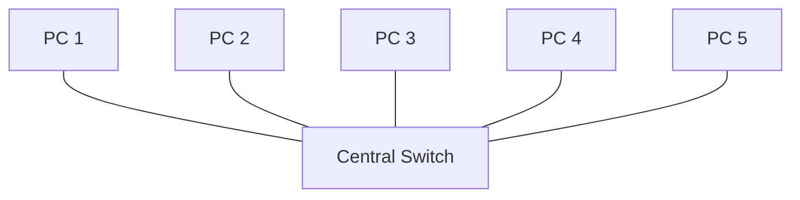
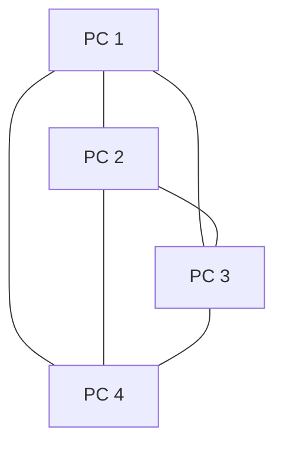

# 🌐 Network Topology

## What is Network Topology?

Network Topology is the graphical representation of nodes in a network. It describes how different devices are connected to each other and how they communicate within a network.

## Types of Network Topologies

1. ⭐ Star Topology (Most Common)
2. 🔗 Mesh Topology (Most Common)
3. 🔄 Ring Topology
4. 🚌 Bus Topology
5. 🌳 Tree Topology
6. 🔀 Hybrid Topology

---

## 1. ⭐ Star Topology

**Definition:**

In Star Topology, all devices are connected to one central device, usually a switch or hub.

**Diagram:**

### Advantages:
- Requires fewer cables.
- Network complexity is low.
- Troubleshooting is easy.

### Disadvantages:
- Single point of failure: If the central switch fails, the entire network stops working.

### Real-World Usage:
Commonly used in offices, schools, homes, and enterprise networks.

### 🔐 Security Perspective (SOC / IAM / Cloud Security)

- The central switch connects multiple devices, making it an important point in the network.
- SOC analysts can monitor network traffic to identify suspicious activities.
- Unauthorized devices should not be allowed to connect to the network.
- In cloud environments, similar centralized network designs help manage communication between resources.

---

## 2. 🔗 Mesh Topology

**Definition:**

In Mesh Topology, each node is connected to other nodes, creating multiple communication paths. This allows devices to communicate through alternative paths if one link fails.

**Diagram:**

### Advantages:
- If a link between PC1 and PC2 goes down, they may still communicate using an alternative path
