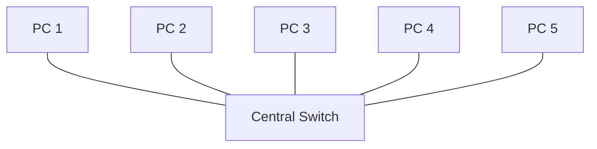
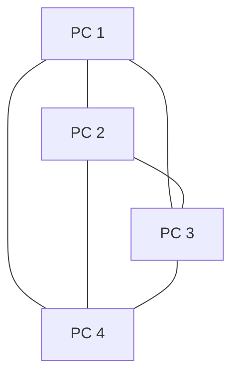
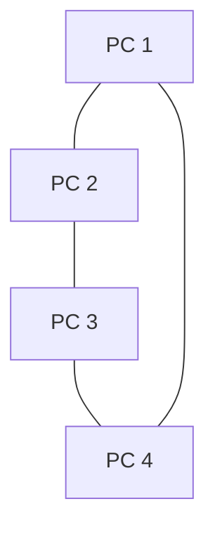
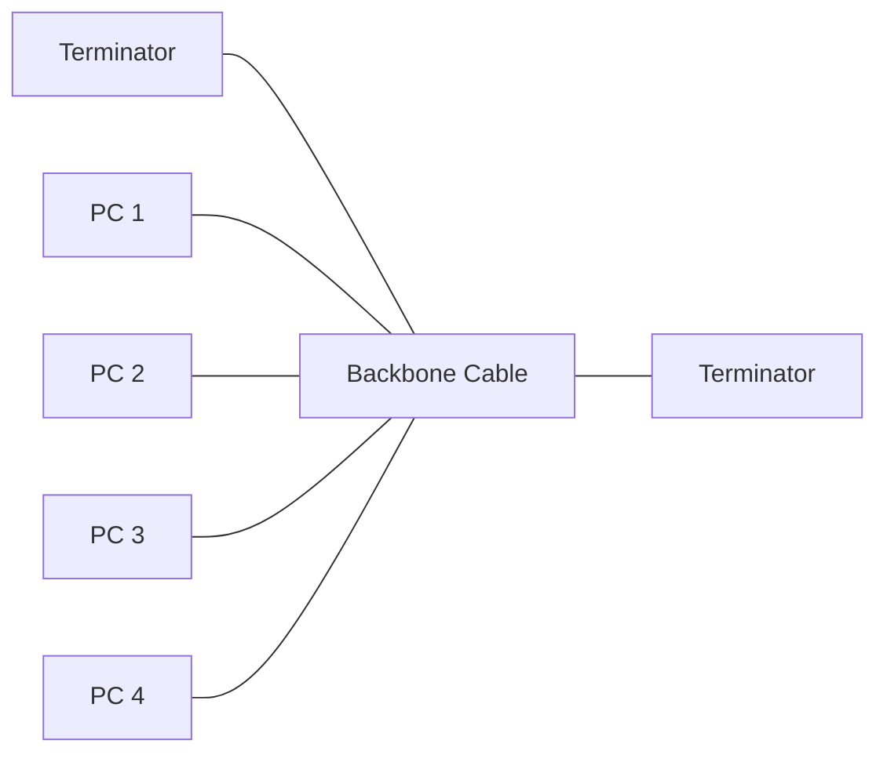
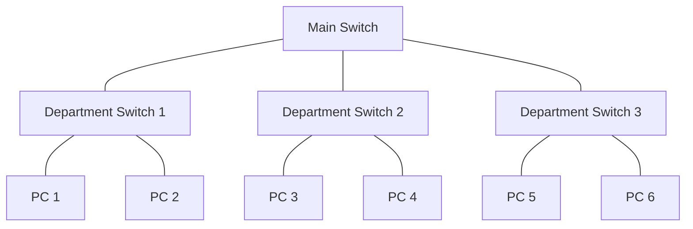
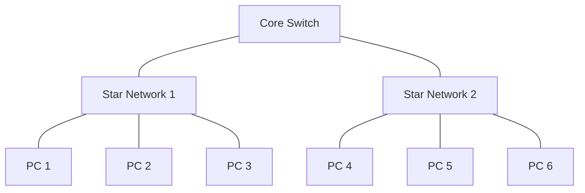

# 🌐 Network Topology

## What is Network Topology?

Network Topology is the graphical representation of nodes in a network. It describes how different devices are connected to each other and how they communicate within a network.

## Types of Network Topologies

1. ⭐ Star Topology (Most Common)
2. 🔗 Mesh Topology (Most Common)
3. 🔄 Ring Topology
4. 🚌 Bus Topology
5. 🌳 Tree Topology
6. 🔀 Hybrid Topology

---

## 1. ⭐ Star Topology

**Definition:**

In Star Topology, all devices are connected to one central device, usually a switch or hub.

**Diagram:**

### Advantages:
- Requires fewer cables.
- Network complexity is low.
- Troubleshooting is easy.

### Disadvantages:
- Single point of failure: If the central switch fails, the entire network stops working.

### Real-World Usage:
Commonly used in offices, schools, homes, and enterprise networks.

### 🔐 Security Perspective (SOC / IAM / Cloud Security)

- The central switch connects multiple devices, making it an important point in the network.
- SOC analysts can monitor network traffic to identify suspicious activities.
- Unauthorized devices should not be allowed to connect to the network.
- In cloud environments, similar centralized network designs help manage communication between resources.

---

## 2. 🔗 Mesh Topology

**Definition:**

In Mesh Topology, each node is connected to other nodes, creating multiple communication paths. This allows devices to communicate through alternative paths if one link fails.

**Diagram:**

### Advantages:
- If a link between PC1 and PC2 goes down, they may still communicate using an alternative path.
- Provides redundancy.
- Reduces the chances of a single link failure interrupting communication.

### Disadvantages:
- Requires more cables.
- Network complexity is high.
- Troubleshooting can be difficult.
- Network downtime can still occur if multiple links or critical devices fail.

### Real-World Usage:
WAN connections, enterprise networks, wireless mesh networks, and critical infrastructure.

### 🔐 Security Perspective (SOC / IAM / Cloud Security)

- Multiple communication paths make it important to monitor network traffic.
- SOC analysts should monitor different paths to identify suspicious communication.
- Attackers may try to use alternative paths to access other devices.
- Proper firewall rules help control communication between devices.

---

## 3. 🔄 Ring Topology

**Definition:**

In Ring Topology, each computer is connected to two neighboring computers, forming a circular connection.

**Diagram:**

### Advantages:
- Organized data transmission.
- Token passing can prevent data collisions.
- Each device gets an opportunity to transmit data.

### Disadvantages:
- A single cable or device failure can disrupt a traditional ring network.
- Adding or removing devices can affect the network.
- Troubleshooting can be difficult.

### Real-World Usage:
Used in older Token Ring networks and some specialized network technologies.

### 🔐 Security Perspective (SOC / IAM / Cloud Security)

- A failure in the communication path can affect network availability.
- SOC analysts should monitor network availability and unusual traffic.
- Unauthorized devices connected to the network can create security risks.
- Only authorized devices should be allowed to access network resources.

---

## 4. 🚌 Bus Topology

**Definition:**

In Bus Topology, all computers are connected to a single main cable called the **Backbone Cable**.

Terminators are placed at both ends of the cable to prevent signal reflection.

**Diagram:**

### Advantages:
- Easy to install.
- Requires less cable.
- Low cost.

### Disadvantages:
- If the main backbone cable fails, the entire network stops working.
- Network performance decreases when more devices are connected.
- Difficult to troubleshoot.

### Real-World Usage:
Mostly found in older computer networks.

### 🔐 Security Perspective (SOC / IAM / Cloud Security)

- Since devices share the same communication medium, network traffic may be exposed to unauthorized monitoring.
- Encryption helps protect sensitive data during communication.
- SOC analysts should monitor unusual network traffic.
- Unauthorized devices should not be allowed to connect to the network.

---

## 5. 🌳 Tree Topology

**Definition:**

Tree Topology is a hierarchical network structure that combines multiple Star Topologies.

- It has a central or root device.
- Multiple switches connect to the main switch, and computers connect to these secondary switches.
- The structure looks like a tree with branches.

**Diagram:**

### Advantages:
- Easy to expand.
- Suitable for large organizations.
- Departments can be organized separately.
- Easy to manage network segments.

### Disadvantages:
- Failure of the main backbone or central device can affect multiple departments.
- Requires more cables and devices.
- Configuration and maintenance can be complex.

### Real-World Usage:
Large offices, universities, and enterprise networks.

### 🔐 Security Perspective (SOC / IAM / Cloud Security)

- Different departments can have separate network segments.
- Firewalls can control communication between departments.
- IAM ensures that employees can access only the resources they are authorized to use.
- SOC analysts can monitor communication between departments to identify unauthorized access.

---

## 6. 🔀 Hybrid Topology

**Definition:**

Hybrid Topology is a combination of two or more different network topologies.

**Diagram:**

### Advantages:
- Flexible network design.
- Easy to expand.
- Can provide high reliability.
- Suitable for large organizations.

### Disadvantages:
- Expensive to implement.
- Complex network design.
- Requires skilled network administrators.

### Real-World Usage:
Large enterprises, data centers, and campus networks.

### 🔐 Security Perspective (SOC / IAM / Cloud Security)

- Different network segments can have different security rules.
- Firewalls help control communication between network segments.
- IAM helps ensure that only authorized users can access network resources.
- SOC analysts can monitor network traffic to identify suspicious activities.

---

## 📚 Reference

- [Cisco Networking Academy](https://www.netacad.com/)
- [Cisco – What Is Network Topology?](https://www.cisco.com/site/us/en/learn/topics/networking/what-is-network-topology.html)

---

**Key Point:** Understanding network topology helps us understand how devices communicate, how networks are connected, and how security can be implemented to protect an organization's network.
